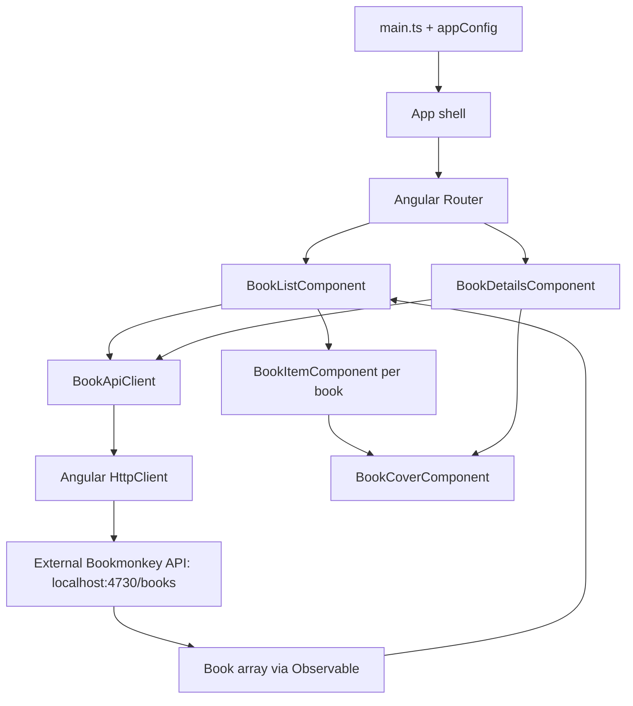

# Architecture

BookMonkey is a small Angular workshop application that displays and searches a book collection. This summary describes the implementation currently present in this repository.

## Tech stack and dependencies

Versions below are declared in [package.json](package.json); [package-lock.json](package-lock.json) records the resolved dependency tree.

| Technology                | Declared version | Role in this application                                                                                |
| ------------------------- | ---------------- | ------------------------------------------------------------------------------------------------------- |
| Angular                   | 20.2.1           | Standalone components, dependency injection, routing, HTTP requests, and template-driven forms.         |
| TypeScript                | 5.9.2            | Application code with strict TypeScript and Angular template checks.                                    |
| RxJS                      | 7.8.0            | Feature-local request/state streams consumed through `AsyncPipe`; `switchMap` coordinates cancellation. |
| Zone.js                   | 0.15.0           | Change detection, configured with event coalescing.                                                     |
| Tailwind CSS / PostCSS    | 4.1.12 / 8.5.6   | Utility classes used throughout the templates; Tailwind is processed through `@tailwindcss/postcss`.    |
| Angular Material / CDK    | ^20.2.0 / 20.2.0 | Material snack bar support in the shared toast service, with an SCSS color override.                    |
| Angular CLI / build tools | 20.2.0           | Development server and application builds through `@angular/build`.                                     |
| Playwright                | ^1.55.0          | Browser test tooling configured for Chromium, Firefox, and WebKit.                                      |
| Prettier                  | 3.6.2            | Source formatting, configured in `.prettierrc`.                                                         |

Several dependencies are installed but are not integrated into the current application flow:

- `@ngrx/signals` (20.0.1), `@angular-architects/ngrx-toolkit` (^20.1.0), and `@tanstack/angular-query-experimental` (^5.85.5): no store or query client is configured or used.
- `@angular/platform-server` and `@angular/ssr` (20.2.1), and Express (5.1.0): no server entry point or SSR build configuration is present. The app currently renders in the browser.

`tslib` (2.3.0) supplies TypeScript runtime helpers; Node and Express type packages support development tooling.

## Structure and responsibilities

The application uses standalone components rather than NgModules. Code is grouped around the books feature, with a small shared service folder.

| Location                                                                               | Responsibility                                                                                                         |
| -------------------------------------------------------------------------------------- | ---------------------------------------------------------------------------------------------------------------------- |
| [src/main.ts](src/main.ts)                                                             | Bootstraps the root `App` component using `bootstrapApplication` and `appConfig`.                                      |
| [src/app/app.config.ts](src/app/app.config.ts)                                         | Registers browser error listeners, zone-based change detection, routing, `HttpClient`, and animations.                 |
| [src/app/app.ts](src/app/app.ts), [app.html](src/app/app.html)                         | Application shell: header, router outlet, and footer.                                                                  |
| [src/app/app.routes.ts](src/app/app.routes.ts)                                         | Maps `/` to the list and `/books/:id` to details; the wildcard redirects to the list.                                  |
| [src/app/books/book-list.component.ts](src/app/books/book-list.component.ts)           | Owns loading, search, and book-list state; requests data and renders loading, empty, and list views.                   |
| [src/app/books/book-item.component.ts](src/app/books/book-item.component.ts)           | Displays one book received through an input, including cover fallback, title, subtitle, author, and ISBN.              |
| [src/app/books/book-details.component.ts](src/app/books/book-details.component.ts)     | Owns route-driven loading, expected 404 handling, and retry; renders bibliographic details in an external template.    |
| [src/app/books/book-cover.component.ts](src/app/books/book-cover.component.ts)         | Shared feature-local cover rendering; handles missing/broken images and resets failure on URL changes.                 |
| [src/app/books/request-error.component.ts](src/app/books/request-error.component.ts)   | Shared feature-local inline error presentation and retry action.                                                       |
| [src/app/books/book-api-client.service.ts](src/app/books/book-api-client.service.ts)   | Root-provided service that encapsulates HTTP access to the books endpoint.                                             |
| [src/app/books/book.ts](src/app/books/book.ts)                                         | Defines the `Book` response shape, including identity, bibliographic information, price, cover, abstract, and user ID. |
| [src/app/shared/toast.service.ts](src/app/shared/toast.service.ts)                     | Root-provided wrapper around Material's `MatSnackBar`; currently not called by the books feature.                      |
| [src/app/shared/http-error.interceptor.ts](src/app/shared/http-error.interceptor.ts)   | Reports network/server failures and unexpected 404s, then rethrows unchanged; expected detail 404s remain local.       |
| [src/app/shared/error-reporting.service.ts](src/app/shared/error-reporting.service.ts) | Central console diagnostics and global Angular error handler, with duplicate error-object suppression.                 |
| [src/styles.css](src/styles.css), [src/material-theme.scss](src/material-theme.scss)   | Global Tailwind import and Material snack bar styling.                                                                 |
| `public/`                                                                              | Static assets copied by the Angular build, currently including the favicon.                                            |

## Runtime architecture and data flow

On initialization, `BookListComponent` requests books through the injected `BookApiClient`. The service sends `GET http://localhost:4730/books` with `_limit` set to the component's `pageSize` input, which defaults to 10. Search adds a `q` query parameter; filtering is delegated to the API. There is no pagination offset or page navigation in the current UI.

The search input uses `FormsModule` and explicit model-change events. Search and page-size subjects feed one list state stream. An outer `switchMap` cancels previous debounce/HTTP work immediately; nonempty searches wait 300 ms, while clearing and retrying load immediately. Page-size changes reload the list. The external template renders loading, error, or success states and tracks books by ID.

State is feature-local: the list and details expose typed state streams, each consumed by one template `AsyncPipe`. Details react to route ID changes and retry events through nested `switchMap` flows. Subscriptions, HTTP requests, and pending debounce timers are disposed when the view is destroyed. There is no global store, query cache, or browser persistence. The `Book` interface provides compile-time typing; responses are not validated at runtime.

Both views show inline failures and offer retry. Detail 404s have a distinct non-retry state and are marked as expected in HTTP context. The interceptor reports network errors, server errors, and unexpected 404s to `ErrorReportingService`, then rethrows the original error to the feature. Uncaught Angular errors use the same reporter through `ApplicationErrorHandler`; duplicate error objects are reported once. Reporting currently uses the console, with no remote telemetry or global error toasts. Bootstrap failures before application initialization are logged by `main.ts`.

## Backend and external resources

The backend is a separate development service, not implemented in this repository. Start it with `npx bookmonkey-api` as described in the [README](README.md). Its endpoint documentation is available at `http://localhost:4730` while it is running.

The API endpoint is injected through `BOOK_API_URL`, supplied in application configuration with the development default `http://localhost:4730/books`. Override that provider for another backend; there is no runtime configuration loader or development proxy. `BookApiClient` owns query parameters, ID encoding, and expected-404 context. The browser also loads Google Fonts and Material Icons from external URLs in `src/index.html`, and book cover images from URLs supplied by the API.

## Build and validation

The application supports Light and Dark through an icon-only, two-segment toggle in the shared header. Both buttons
have accessible names and expose their selected state. The selector keeps its markup in an external template;
`ThemeService` separates initialization from browser preference reads, persistence, and document updates.
`ThemeService` is initialized before the shell renders. It
restores `bookmonkey.theme` from local storage; if no valid Light/Dark choice exists, it reads `prefers-color-scheme`
once and saves that resolved mode. Former System values are migrated in the same way. Later system changes do not
affect the selected theme, and only Light/Dark values are saved. The mode is applied through `data-theme` and
`color-scheme` on the document root. Unavailable storage falls back to session-only selection without blocking the app.
Semantic Tailwind color tokens in
`src/styles.css` style the shell, books, request states, inputs, and focus indicators consistently in both modes;
Material snack bars consume the same colors. `tests/theme.spec.ts` covers browser behavior and
`src/app/shared/theme.service.spec.ts` checks initialization, saved preferences, and migration of the former System option.

- `npm start` runs the Angular development server, normally at `http://localhost:4200`. The API must be started separately.
- `npm run build` uses the production configuration by default, with hashed output filenames and bundle/style size budgets. `npm run watch` builds continuously using the development configuration, which enables source maps and disables optimization.
- `npm run format.write` formats supported files under `src/`; its glob does not include root-level Markdown documentation.
- `npm test -- --watch=false --browsers=ChromeHeadless` runs Karma/Jasmine tests in `src/app/books/books.spec.ts`. Dependencies are declared, with Jasmine 5 compatible with the current Zone.js test integration. Tests cover HTTP configuration, cancellation, global reporting, list debounce/clear/retry, page-size changes, destruction, and cover recovery. Set `CHROME_BIN` if Chrome is not installed in the default location.
- `npx playwright test` runs application tests with mocked API responses; no backend is required. `playwright.config.ts` provides `baseURL` and starts or reuses the development server on `BOOKMONKEY_TEST_PORT` (default 4200). Tests cover keyboard navigation, direct links, real history navigation, late responses, inline error/retry, cover fallback, literal text, and narrow layouts. Reusable fixtures match book IDs explicitly. External website and TodoMVC examples live in `tests-examples/`, outside `testDir`.

The shell hosts navigation; list and detail containers own local request state; item, cover, and error components own presentation; the API client owns transport details. Editing, authentication, and backend persistence are not implemented. See [REFACTORING.md](REFACTORING.md) for the original findings and their implementation status.

## Historical architectural assessment (before refactoring)

The assessment below records the baseline that motivated the refactoring. Its request-coordination, hard-coded client
endpoint, and missing-coverage findings have since been addressed as described above. It is retained as historical
context, not as a statement of current defects. Installed unused dependencies and lack of runtime API validation remain.

**Overall: moderate architectural risk, with high risk in request coordination and application verification.** This is a coherent workshop baseline. The following assessment assumes evolution into a maintained product; team size and deployment requirements are unknown. Findings come from source and configuration inspection; builds and tests were not executed for this review.

### Style, boundaries, and coupling

- The style is feature-oriented and component-driven, with a thin transport service layer. There is no substantial domain layer.
- Implicit boundaries separate application composition, the books feature, and shared notification infrastructure. Folder conventions establish these boundaries; no lint rules or separate projects enforce them.
- Dependencies run from router to list, from list to API client and item, and from client to Angular HTTP. No circular application imports are visible.
- Angular dependency injection provides substitution points, but the list depends on a concrete transport service and both UI components consume its response model directly.
- State is local and mutable. Data flows downward through component inputs, but overlapping requests can violate temporal consistency. There is no mutable global business state.

### Critical topics and risk ratings

| Topic                 | Risk     | Assessment                                                                                                                                                                                                        |
| --------------------- | -------- | ----------------------------------------------------------------------------------------------------------------------------------------------------------------------------------------------------------------- |
| Modularity            | Low      | The books folder is cohesive and the list/item split is useful. No cross-feature leakage is visible, although only one feature exists. Shared infrastructure is small.                                            |
| Dependency management | Moderate | No visible cycles; DI supports replacement. UI and transport share the same model. Unused state and server packages leave the intended dependency baseline unclear.                                               |
| State management      | High     | Local state is appropriate, but request ordering, loading transitions, and error representation are unreliable. A centralized store would not automatically solve these defects.                                  |
| Scalability           | Moderate | Sibling features and route entries provide a straightforward extension path. Shared server-state ownership, feature routing, and error conventions are not established.                                           |
| Testability           | High     | The client is mockable and the item is easy to isolate, but application behavior has no test coverage in the checked-in tests. Timer and subscription coordination increases testing complexity.                  |
| Build and tooling     | Moderate | Standard Angular configuration, strict compilation, and size budgets are strengths. Karma/Jasmine setup is incomplete, test styles omit the Material SCSS included in builds, and no CI configuration is visible. |

### Recurring patterns

| Pattern                                 | Location and consistency                                                                     | Suitability and long-term risk                                                                                       |
| --------------------------------------- | -------------------------------------------------------------------------------------------- | -------------------------------------------------------------------------------------------------------------------- |
| Container / presentational              | List coordinates requests and state; item renders an input. Applied within the only feature. | Appropriate. Adding editing, permissions, and pagination directly to the list would concentrate responsibilities.    |
| Feature folders                         | Books components, client, and model are colocated.                                           | Appropriate; cross-feature consistency cannot yet be evaluated.                                                      |
| Root-provided services                  | API client and toast wrapper.                                                                | Appropriate for stateless transport and notification services; neither currently owns shared mutable business state. |
| Imperative asynchronous orchestration   | List combines an HTTP subscription with a manual timer.                                      | Incomplete cancellation and lifecycle ownership create current correctness problems.                                 |
| Utility styling with Material overrides | Tailwind templates and global snack-bar SCSS.                                                | Compatible responsibilities, but Material currently supports an unused service.                                      |

No application barrels, global event buses, hooks, or context-based state containers are present.

### Architectural snowflakes

Origins below are inferred; no ADR establishes whether these choices are intentional.

| Inconsistency                                                 | Likely origin / intent                                          | Risk     | Recommendation                                                                                                                                  |
| ------------------------------------------------------------- | --------------------------------------------------------------- | -------- | ----------------------------------------------------------------------------------------------------------------------------------------------- |
| NgRx and TanStack packages without consumers                  | Workshop options or prepared exercises; unconfirmed.            | Moderate | Remove unused packages or document their instructional purpose. Choose shared server-state infrastructure when a concrete workflow requires it. |
| SSR and Express packages without server code                  | Starter residue or planned exercises; unconfirmed.              | Moderate | Reconcile the manifest with the client-only implementation unless server rendering is planned.                                                  |
| Unused toast wrapper while requests log failures              | Notification groundwork that was never integrated; unconfirmed. | Moderate | Add an explicit list error state. Keep the wrapper only if transient notification consumers exist.                                              |
| Manual debounce alongside RxJS requests                       | Likely a minimal initial implementation.                        | High     | Use one cancellation-aware query flow for typing, clear, and component destruction.                                                             |
| Karma setup and unrelated Playwright examples                 | Likely incomplete scaffold setup.                               | High     | Complete the selected unit runner and replace sample browser tests with BookMonkey coverage.                                                    |
| Mixed inline/external templates and unused item router import | Likely ordinary scaffolding history.                            | Low      | Remove unused imports; move the list template only if it improves reviewability.                                                                |

### Known and latent issues

| Issue                                           | Risk / classification                          | Concrete consequence and action                                                                                                                                                                |
| ----------------------------------------------- | ---------------------------------------------- | ---------------------------------------------------------------------------------------------------------------------------------------------------------------------------------------------- |
| Overlapping requests accept every response      | High / maintainability and runtime correctness | An older response can replace newer search results; any response can clear loading while another request remains active. Give the current query ownership of result, loading, and error state. |
| Errors clear loading without error state        | High / maintainability and runtime correctness | Initial failure appears as an empty collection; failed searches can show previous results under a new query. Represent failure explicitly and provide retry.                                   |
| Hard-coded localhost API                        | Moderate / structural and organizational       | A deployed browser targets the user's machine. Supply the base URL through configuration or an appropriate relative API path.                                                                  |
| Pending timers survive clear and destruction    | Moderate / performance and maintainability     | Clear can issue an immediate request followed by a duplicate timer request; destroyed components can still initiate work. Bind effects to query and component lifetimes.                       |
| Transport model doubles as presentation model   | Moderate / structural                          | API changes propagate into templates, and compile-time typing does not validate responses. Introduce validation or mapping when contract variability or transformations justify it.            |
| `pageSize` input changes do not trigger loading | Low / maintainability                          | The public input suggests behavior the component does not implement. Treat it as fixed configuration or include changes in the query flow.                                                     |

The list is an orchestration hotspot, not yet a god component. No current abstraction inversion, cross-feature boundary erosion, or mutable global business state is evident.

### Architectural smells

- **Over-engineering is concentrated in the manifest:** several frameworks are declared for capabilities absent from the source. Implementation indirection is otherwise limited.
- **Effect coordination is under-abstracted:** debounce, cancellation, loading, and failure need one coherent feature-local owner.
- **Duplication is not established:** a single feature does not justify generic repositories, base components, or a shared CRUD layer.
- **An accidental monolith is not present:** a single build and eager route are reasonable today. Repeating eager imports across substantial features would increase startup cost.
- **Framework coupling is expected:** UI and DI are Angular-specific; the plain response type remains portable. Framework-neutral ports are not justified by current domain complexity.
- **Verification can give false confidence:** browser tests can pass without exercising any BookMonkey behavior.

### Evolution and priorities

- **2x team size:** conditionally supportable. Separate feature folders allow parallel work, but the current team size is unknown. Agree on request handling, dependency selection, and verification expectations before expanding parallel development.
- **3x feature growth:** supportable for similarly small features through sibling folders and feature-owned routes. Editing, authentication, or cross-route invalidation will require explicit state ownership.
- **Entropy will accumulate** in stateful list components, inconsistent error conventions, unowned shared helpers, speculative dependencies, and divergent build/test configuration.
- **First failure points:** search consistency is already exposed; deployment encounters the localhost endpoint; subsequent feature changes lack regression protection. Shared workflows would next expose invalidation and ownership gaps.

Recommended implementation order:

1. Correct query concurrency and lifecycle handling, including clear-search behavior and explicit error state.
2. Verify latest-query-wins, clear during debounce, initial/refresh failures, and API parameters. Add a BookMonkey browser flow with controlled responses.
3. Externalize endpoint configuration.
4. Reconcile test tooling and remove or explain unused dependencies.
5. Establish feature route ownership, import boundaries, shared server-state ownership, and shared UI admission rules as additional features arrive.

The existing feature structure is a suitable base. Current evidence supports targeted corrections rather than a platform rewrite.
